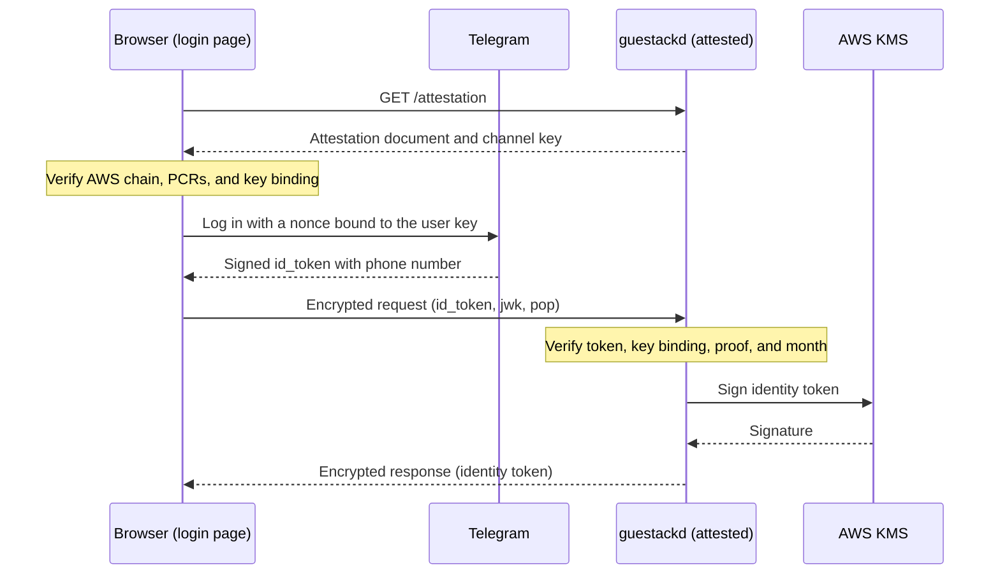

# Guestack Server

> The attested backend of Guestack. It proves that a visitor controls a Telegram account with a verified phone number, without the website, the operator, or the network learning that number.

Websites receive a pseudonymous **guest ID** instead of a phone number. The same number maps to the same guest ID for one UTC calendar month, so a site can recognise returning guests, rate limit them, and ban them. Every guest ID changes the next month.

This repository contains `guestackd`, the Go service that checks the Telegram login and issues a signed **identity token**, along with the protocol specifications and test vectors that the other Guestack components conform to. It is public so that anyone can audit what runs inside the attested instance.

> [!WARNING]
> **Not ready for production.** The dev build works end to end. NitroTPM attestation and the machine image exist but have not yet been verified on a real instance.

## Features

- **Attested encryption:** the browser checks an AWS NitroTPM attestation document, then encrypts to the key bound in it using HPKE (RFC 9180).
- **Phone numbers stay in memory:** they never reach logs, metrics, errors, panics, or disk.
- **No runtime configuration:** the production binary reads no environment variables or configuration files. Its settings are compiled in and measured.
- **Key-bound login:** a captured Telegram token cannot be reused for another key, because its nonce commits to the user's key and a proof of possession is required.
- **Monthly epochs:** each release serves exactly one month, and registration is gated on Telegram's signed time rather than the instance clock.
- **Small dependency surface:** all cryptography comes from the Go standard library. Each third-party module is justified in [`DEPENDENCIES.md`](DEPENDENCIES.md).

## How it works



The browser later uses the identity token and the user's key to prove its guest ID to a website. The backend takes no part in that step and never learns which sites a user visits.

## Getting started

### Prerequisites

- [Go](https://go.dev/dl/) 1.21 or later. `go.mod` pins go1.27.4, and Go downloads it automatically unless `GOTOOLCHAIN` is set to prevent that.
- GNU Make

### Run a dev backend

```sh
git clone https://github.com/hylswind/guestack-server.git
cd guestack-server
make run-dev
```

The dev backend listens on `127.0.0.1:8080` and serves the current UTC month. It uses the same HTTP API and document format as production, with throwaway trust anchors.

### Register a test user

In a second terminal:

```sh
curl http://127.0.0.1:8080/healthz
go run -tags dev ./cmd/devclient -phone 15550001234
```

The client verifies the attestation, performs one full registration over the encrypted channel, and checks the identity token it receives:

```text
attestation verified; hpke_pk BKw57RYn...
{
  "boot": "q3Sr40NejDw",
  "exp": "2026-12-01T00:00:00Z",
  "identity": "eyJhbGciO...",
  "sub": "cc8895f7-91ca-8708-aa4d-85d3b9be0e22"
}
```

`sub` is the guest ID, and `exp` is the end of the current month.

## HTTP API

| Endpoint | Purpose |
|----------|---------|
| `GET /attestation` | Attestation document and channel public key |
| `POST /rpc` | Encrypted method call. `register` is the only method |
| `GET /healthz` | Liveness check, answers `ok` |

There are no debug or profiling routes. The formats are defined in [`spec/channel.md`](spec/channel.md) and [`spec/registration.md`](spec/registration.md).

## Development

```sh
make check                    # Lint and test both builds
make test                     # Race-enabled tests, with and without -tags dev
make test-short               # Skip tests that build and run the binary
make lint                     # go vet, staticcheck, and gofmt for both builds
make vectors                  # Regenerate spec/vectors, then review the diff
make build EPOCH_ID=2026-12   # Release build for one month
```

### Production and dev builds

The two builds differ only by the `dev` build tag. There is no runtime switch.

| | Production | Dev (`-tags dev`) |
|---|---|---|
| Attestation | NitroTPM, through `nitro-tpm-attest` | Real format, throwaway root |
| Issuer key | AWS KMS | Local key |
| Telegram keys | Fetched from Telegram's JWKS | Static dev keys |
| Environment variables | None | `GUESTACK_LISTEN_ADDR`, `GUESTACK_DEV_SECRET` |

> [!CAUTION]
> Never put a dev-only string in an untagged file. `TestProductionBinaryHasNoDevSymbols` scans the production binary for dev package paths, key material, and dev configuration names.

### Project structure

```text
cmd/
├── guestackd/          Service entry point and build-specific wiring
└── devclient/          Command-line client for a dev backend
internal/
├── api/                HTTP handlers and RPC dispatch
├── attest/             Attestation cache, NitroTPM and dev providers
├── binding/            Nonce and proof-of-possession checks
├── channel/            HPKE request and response protection
├── devclient/          Go reference client (dev build)
├── devkeys/            Throwaway dev keys (dev build)
├── epoch/              Compiled-in month and its time window
├── issuer/             Identity token assembly and KMS signer
├── jose/               JWS, JWK, and base64url helpers
├── phone/              Phone normalisation and policy
├── registration/       The ordered registration rules
├── safelog/            The only logging API
├── secret/             In-memory secret and guest ID derivation
├── telegram/           id_token verification and JWKS fetching
└── vectors/            Test vector loader
image/                  KIWI NG description of the attested machine image
spec/                   Protocol specifications and test vectors
```

### Machine image

The image is built only by the manual [`Build image`](.github/workflows/build-image.yml) workflow, on a GitHub-hosted runner. `EPOCH_ID` is written in that workflow file, so each month's build is a commit that changes it. The workflow signs the image's PCR values with GitHub build provenance. See [`image/INPUTS.md`](image/INPUTS.md) for what the build depends on.

## Auditing this repository

Start with the [specifications](spec/README.md), then check how each property is enforced. To tie a running backend to a commit of this repository, follow [`VERIFY.md`](VERIFY.md).

| Property | Enforced by |
|----------|-------------|
| Secrets and phone numbers never leave memory | `TestPrivacy`, [`internal/safelog`](internal/safelog) |
| Every registration rule holds, in order | `TestRules` |
| Production reads no environment variables | `TestProductionReadsNoEnvironment` |
| Production contains no dev code or keys | `TestProductionBinaryHasNoDevSymbols` |
| Production fails closed on bad startup state | `TestProductionStartupFailsClosed` |
| The JWKS fetch never leaves HTTPS | `TestFetcherRedirects` |
| The code matches the published formats | The `*Vectors` tests, against [`spec/vectors`](spec/vectors) |

> [!IMPORTANT]
> Some limits are accepted by design:
>
> - The operator controls the signing key and is trusted not to forge identity tokens. The operator is **not** trusted with phone numbers.
> - A guest ID is the same across all websites for the month, so two sites can match a guest.
> - The guest ID secret is never persisted, so a restart changes every guest ID for the rest of the month.
