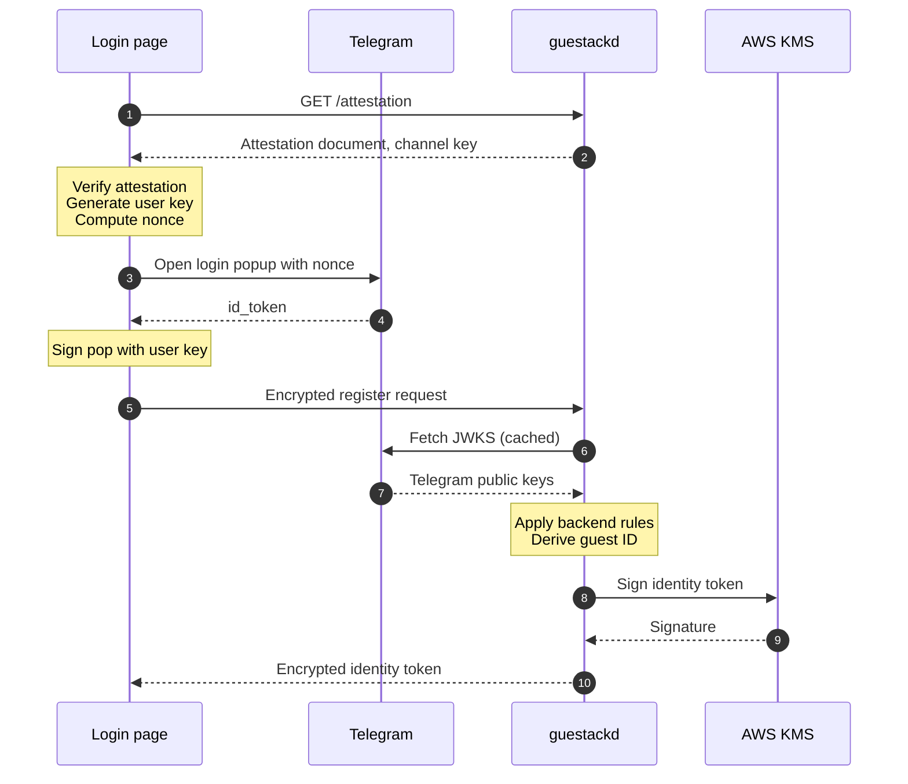

# Registration

> The `register` method: how a Telegram login and a user key become an identity token.

**Status:** v1 · **Vectors:** [`nonce.json`](vectors/nonce.json), [`pop.json`](vectors/pop.json), [`phone.json`](vectors/phone.json)

The Telegram `nonce` claim was confirmed with a real login ([`external-notes.md`](external-notes.md), "Telegram login").

> [!IMPORTANT]
> **Timing.** Telegram `id_token`s were observed to expire 30 s after `iat`. The login page should verify the attestation and hold the channel key **before** it opens the Telegram popup.

## Flow



| Stage | Steps | What happens |
|-------|-------|--------------|
| **Prepare** | 1–2 | The login page fetches and verifies the attestation ([`channel.md`](channel.md)), generates a non-extractable P-256 user key, and computes the [nonce](#nonce) from it |
| **Log in** | 3–4 | It calls `Telegram.Login.auth({client_id, scope:["phone"], nonce})` and receives an `id_token` |
| **Register** | 5 | It signs `pop` over `SHA-256(id_token)` with the user key, then sends `id_token`, `jwk`, and `pop` over HPKE |
| **Verify** | 6–7 | The backend checks the token against Telegram's JWKS and applies the [backend rules](#backend-rules) |
| **Issue** | 8–10 | KMS signs the [identity token](identity-token.md), and the backend returns it over HPKE |

The login page requests only the `phone` scope. It treats `id_token` as an opaque string: it does not decode, display, log, or store it.

## Nonce

```
thumbprint = SHA-256(canonical JWK)       -- RFC 7638; the 32 raw bytes, not their base64
nonce      = b64u(SHA-256("guestack/nonce/v1\0" ‖ thumbprint))    -- 43 characters
```

The canonical JWK of a P-256 key is `{"crv":"P-256","kty":"EC","x":"…","y":"…"}`: required members only, in lexicographic order, no whitespace.

Neither the nonce nor `pop` contains the month. The Telegram-signed `iat` fixes the time.

## Request

Inner request `{ "method": "register", "params": P }`, where `P` is exactly:

```json
{ "id_token": "<Telegram id_token>", "jwk": { "kty":"EC","crv":"P-256","x":"…","y":"…" }, "pop": "<compact JWS>" }
```

- `jwk` has exactly the members `kty`, `crv`, `x`, `y`. A private `d` or any other member is rejected. `x` and `y` are 32 bytes each, and the point must be on the curve.
- `pop` is a compact JWS signed with the user key:
  - header exactly `{"alg":"ES256","typ":"guestack-reg+jwt"}` (member order free, no other members);
  - payload exactly `{"h": b64u(SHA-256(id_token bytes))}`;
  - signature raw `r ‖ s`, 64 bytes.

## Result

```json
{ "ok": true, "result": { "identity": "<identity token, see identity-token.md>" } }
```

## Backend rules

All rules are mandatory. They are checked in this order, and the first failure decides the error code.

| # | Check | Error |
|---|-------|-------|
| 1 | `params` is an object with `id_token` (non-empty string), `jwk` (object) and `pop` (non-empty string), and no other members | `bad_request` |
| 2 | `id_token` is a compact JWS. Header `alg` is `RS256` or `ES256`, and nothing else is allowed. `kid` names a key in Telegram's JWKS of the matching type. The signature verifies | `id_token_invalid` |
| 3 | Claims: `iss` = `https://oauth.telegram.org`; `aud` = the decimal string of `TG_CLIENT_ID` (a one-element array holding it is also accepted); `exp` and `iat` are integers; instance time `< exp`; `nonce` and `phone_number`, when present, are strings. A `crit` header member is rejected | `id_token_invalid` |
| 4 | `jwk` is a valid P-256 public key as above | `bad_request` |
| 5 | **Key binding.** The `nonce` claim is a string equal (constant-time) to the nonce recomputed from `jwk` | `key_binding_failed` |
| 6 | **Proof of possession.** `pop` is valid as above and verifies under `jwk` | `pop_invalid` |
| 7 | **Epoch gate.** `epoch_start ≤ iat < epoch_end`, using the Telegram-signed `iat`. The instance clock is not used for this decision | `epoch_not_active` |
| 8 | `phone_number` claim present | `phone_not_shared` |
| 9 | `phone_number` normalises ([identifiers.md](identifiers.md)) | `id_token_invalid` |
| 10 | Phone policy ([identifiers.md](identifiers.md)) | `phone_not_allowed` |
| — | Any failure after the checks: guest ID derivation or signing | `internal` |

Compile-time constants, never configuration: the Telegram issuer, the JWKS URL, and `TG_CLIENT_ID`.

### JWKS

- Fetched starting from `https://oauth.telegram.org/.well-known/jwks.json`.
- Redirects issued by Telegram are followed, but only to `https:` targets (at most 10). A redirect to any other scheme is refused.
- TLS certificates are validated on every hop.
- The response is at most 64 KiB and is cached in memory.
- An unknown `kid` triggers a refresh, at most once per 60 seconds.
- Keys that are not RSA (≥ 2048 bits) or EC P-256 are ignored.

### Error codes

Error codes are a closed enum:

`bad_request`, `id_token_invalid`, `key_binding_failed`, `pop_invalid`, `phone_not_shared`, `phone_not_allowed`, `epoch_not_active`, `internal`.

The login page maps `epoch_not_active` to the month-mismatch message of [`rollover.md`](rollover.md).

## Privacy

The phone number, the Telegram user ID, and the `id_token` exist in plaintext only in the browser and in the instance's memory. The backend never writes them, or `S`, to disk, logs, metrics, panics, or error messages. Error codes carry no detail.
